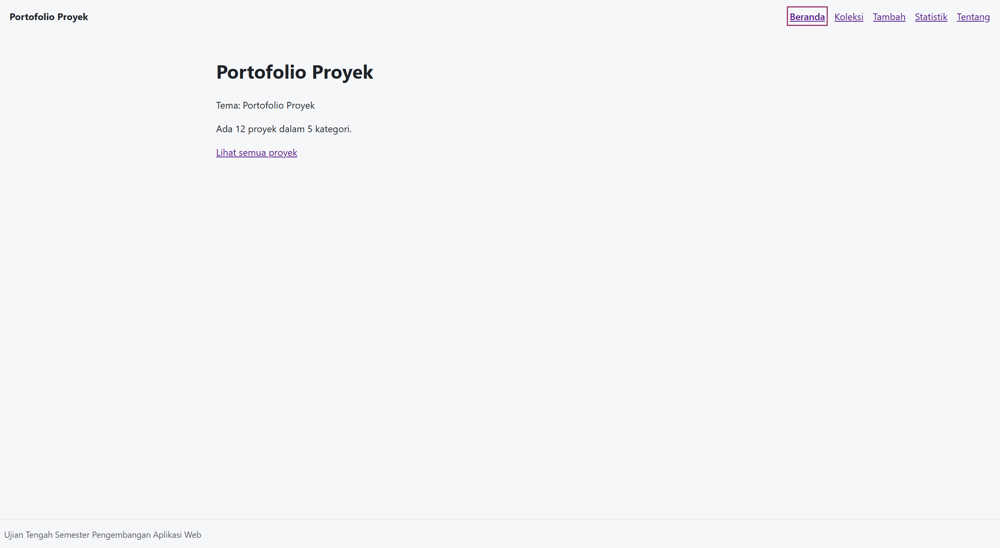

# Ujian Tengah Semester IF25-22014 Pengembangan Aplikasi Web

## README milikmu

Ganti seluruh isi berkas ini dengan dokumentasi aplikasimu (butir rubrik A4). Kerangka berikut boleh dipakai:

```markdown
# Nama Aplikasi

Nama: TARISA MENOVA
NIM: 124140039
Kelas: RA
Tema: Portofolio Proyek
Deployment: https://tarisa177.github.io/uts-paw/

1. Dokumentasi berandadocs/beranda.png


2. Dokumentasi Detail
)

3. Dokumentasi Koleksi
)
 
4. Dokumentasi Statistik
)

5. Dokumentasi Tambah
)

6. Dokumentasi Tentang
)


## Fitur

Menampilkan daftar proyek.

Mencari proyek berdasarkan judul.

Melihat detail proyek.

Menambahkan proyek baru.

Menghapus proyek.

Menampilkan statistik berdasarkan kategori.

## Menjalankan secara lokal

cd app
npm install
npm run dev

## Konsep React yang dipakai

Components

Props

useState dan useEffect

Context API

Custom Hooks

React Router

Fetch API

Local Storage
