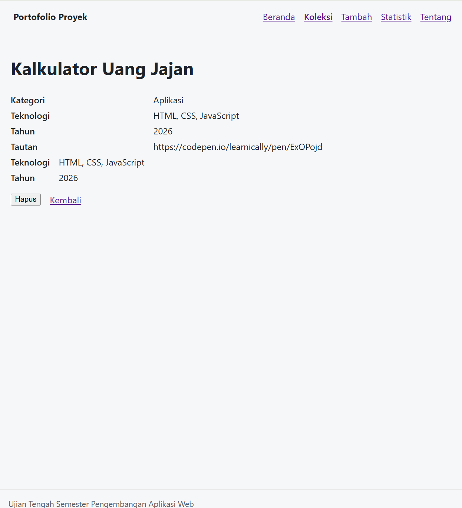
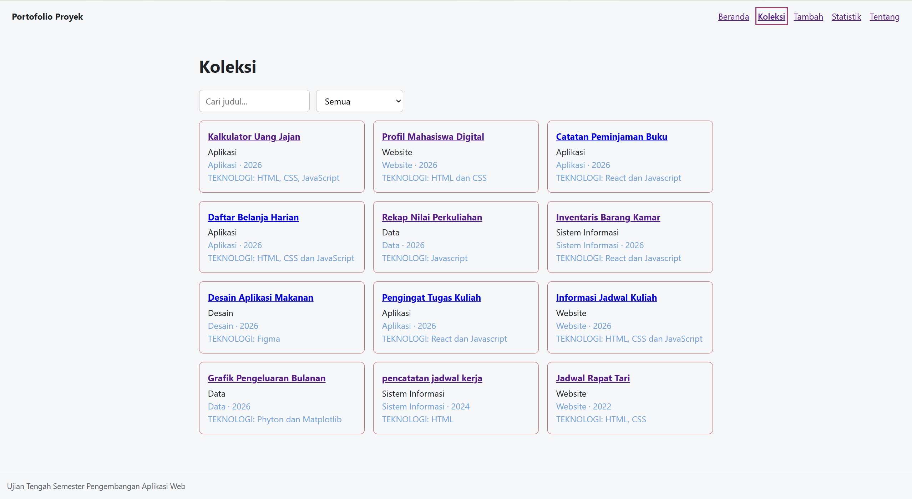
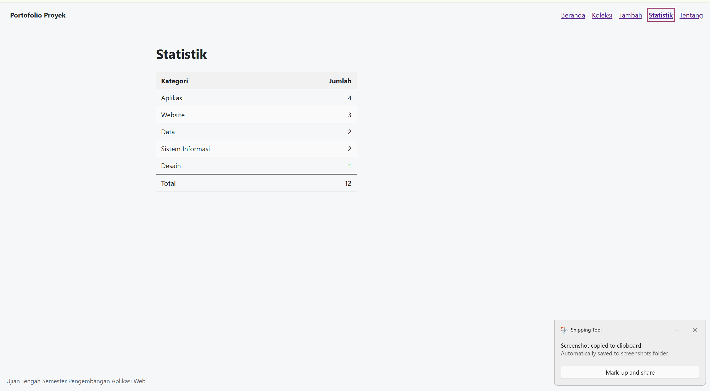
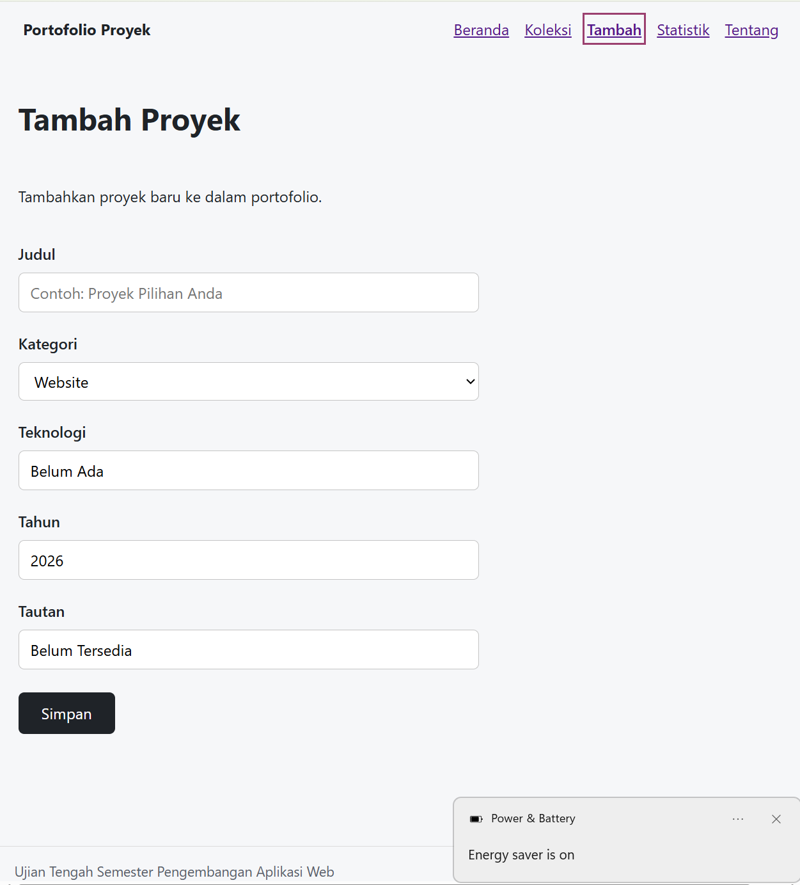
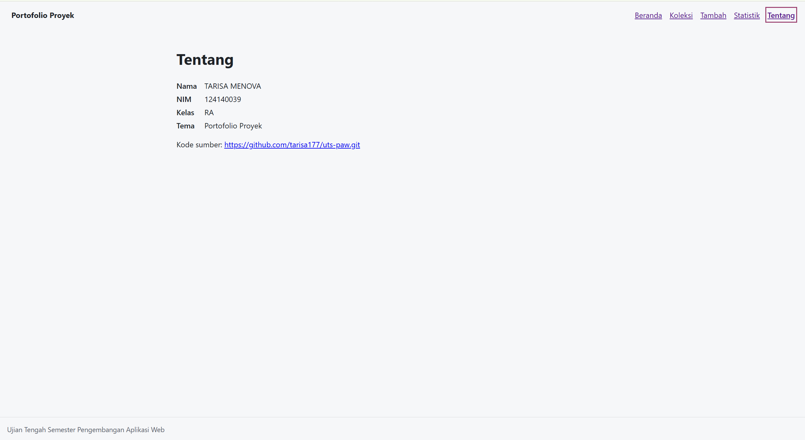

# Ujian Tengah Semester IF25-22014 Pengembangan Aplikasi Web

## README milikmu

Ganti seluruh isi berkas ini dengan dokumentasi aplikasimu (butir rubrik A4). Kerangka berikut boleh dipakai:

```markdown
# Nama Aplikasi

Nama: TARISA MENOVA
NIM: 124140039
Kelas: RA
Tema: Portofolio Proyek
Deployment: https://tarisa177.github.io/uts-paw/

1. Dokumentasi beranda


2. Dokumentasi Detail


3. Dokumentasi Koleksi

 
4. Dokumentasi Statistik


5. Dokumentasi Tambah


6. Dokumentasi Tentang



## Fitur

- ...

## Menjalankan secara lokal

cd app
npm install
npm run dev

## Konsep React yang dipakai

- ...
```
